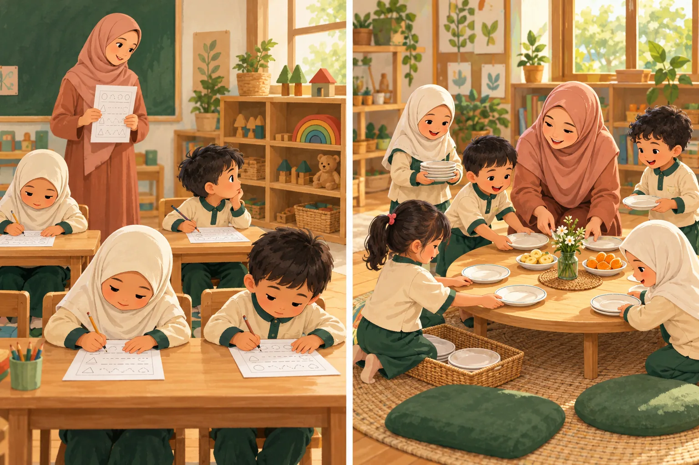

# Ruang PIAUD — Pengantar Ilmu Pendidikan

Portal materi kuliah S1 Pendidikan Islam Anak Usia Dini, UNISMAM Jambi. Pengampu: **Jules Nurhatmi, M.Pd.**

**Edisi 1.1 · 24 Oktober 2026.** 14 unit bergambar, 28 visual utama (14 ilustrasi kasus + 14 diagram konsep), UTS/UAS, peta belajar, bank kasus, glosarium, dan referensi. Semua halaman dapat dibaca tanpa JavaScript. Fitur tambahan: pencarian isi, cek pemahaman, refleksi lokal, ekspor catatan, progres pribadi, dan tampilan cetak.

## Mulai dari sini

[Buka portal kuliah](https://julesnh21.github.io/pengantar-ilmu-pendidikan-piaud/)



Adegan rekaan berbantuan AI. Setiap unit menghubungkan gambar dengan pertanyaan pengamatan, teori, perbandingan tindakan, dan latihan visual.

- [Daftar seluruh materi dalam satu dokumen](docs/MATERI-KOMPILASI.md)
- [Peta kurikulum dan keputusan editorial](handbook/KALIBRASI.md)
- [Petunjuk publikasi GitHub Pages](handbook/PUBLIKASI.md)
- [Laporan pemeriksaan](handbook/QA.md)
- [Panduan visual dan prompt ilustrasi](handbook/ILUSTRASI.md)
- [Riwayat perubahan](CHANGELOG.md)

## Struktur repositori

| Lokasi | Fungsi |
|---|---|
| `content/course.json` | Sumber tunggal teks 14 unit, tujuan, latihan, kunci, refleksi, intisari |
| `content/references.json` | Bibliografi, jenis sumber, URL, dan batas penggunaan |
| `content/visuals.json` | Deskripsi gambar, pertanyaan pengamatan, diagram, perbandingan tindakan, dan latihan visual |
| `assets/scenes/` | 14 ilustrasi kasus WebP yang digunakan portal |
| `assets/` | CSS, JavaScript, dan diagram SVG |
| `scripts/build.py` | Menghasilkan HTML dan kompilasi Markdown dari sumber |
| `scripts/diagrams.py` | Menghasilkan diagram dari data visual |
| `scripts/validate.py` | Memeriksa struktur, sumber, tautan, dan jangkar lokal |
| `docs/` | Hasil siap GitHub Pages; tidak diedit langsung |
| `handbook/` | Dokumentasi editorial, publikasi, dan verifikasi |

## Menyunting dan membangun

Memerlukan Python 3. Tidak perlu npm, framework, akun mahasiswa, atau layanan basis data.

```bash
python3 scripts/diagrams.py
python3 scripts/build.py
python3 scripts/validate.py
```

Buka `docs/index.html` langsung untuk penggunaan lokal. Bila menggunakan server statis, arahkan document root ke `docs/`. Seluruh tautan dan aset relatif sehingga kompatibel dengan subpath GitHub Pages. `index.html` di akar menyediakan pengalihan jika Pages dipasang dari akar.

Edit `content/course.json`, jalankan build dan pemeriksaan, lalu commit sumber **dan** hasil `docs/`. Jangan mengedit HTML hasil secara manual karena perubahan akan tertimpa build berikutnya. Tambahkan alasan revisi akademik pada `CHANGELOG.md`.

## Batas penggunaan

Kompendium baru berdasarkan kerangka mata kuliah yang disepakati; bukan reproduksi naskah lama yang belum tersedia. Kalibrasi internal tidak sama dengan validasi ahli eksternal atau pengesahan RPS. Panduan UTS/UAS dan rubrik adalah usulan pembelajaran, bukan penetapan bobot resmi.

Catatan/progres hanya berada di peramban mahasiswa, tidak dikirim ke dosen. Jangan memasukkan identitas, diagnosis, atau data pribadi anak. Tugas resmi tetap dikelola dosen/LMS.

## Atribusi

Ilustrasi kasus dibuat khusus dengan image generation bawaan dan diberi label rekaan berbantuan AI. Diagram SVG merupakan sintesis pedagogis, bukan salinan diagram buku. Prompt dan daftar aset didokumentasikan pada `handbook/ILUSTRASI.md`. Sumber berhak cipta ditautkan, tidak diunggah ulang. Tidak ada lisensi distribusi umum yang ditetapkan atas nama pemilik repositori; keputusan lisensi berada pada pemilik. Aset pihak ketiga tetap mengikuti hak masing-masing.
