# Pengantar Ilmu Pendidikan — S1 PIAUD

Kompilasi 2.0 · 14 November 2026

[Petunjuk penyuntingan](../README.md)

## Daftar isi

- [1. Hakikat pendidikan dan ilmu pendidikan](#hakikat)

- [2. Manusia sebagai subjek pendidikan](#manusia)

- [3. Tujuan dan fungsi pendidikan](#tujuan)

- [4. Landasan pendidikan](#landasan)

- [5. Pemikiran pendidikan dan implikasinya](#pemikiran)

- [6. Komponen dan proses pendidikan](#komponen)

- [7. Lingkungan dan pusat pendidikan](#lingkungan)

- [9. PAUD dalam sistem pendidikan nasional](#paud)

- [10. Nilai Islam dalam pendidikan anak usia dini](#islam)

- [11. Anak sebagai subjek dan relasi pedagogis](#anak-subjek)

- [12. Bermain, pengalaman, dan lingkungan belajar](#bermain)

- [13. Pendidikan, keluarga, dan kebudayaan](#budaya)

- [14. Tantangan pendidikan dan literasi digital](#kontemporer)

- [15. Profesionalisme dan analisis kasus integratif](#profesional)

## 1. Hakikat pendidikan dan ilmu pendidikan

Membedakan pendidikan, pengajaran, pembelajaran, pengasuhan, dan pelatihan dalam satu kegiatan.

### Tujuan

- Membedakan lima istilah pendidikan

- Menjelaskan hubungan pengalaman dan belajar menurut Dewey

- Memisahkan pertimbangan nilai dari dugaan tentang hasil belajar

### Pendidikan memberi arah pada pengalaman

Pendidikan adalah usaha yang disengaja untuk membantu manusia mengembangkan kemampuan dan membentuk cara bertindak dalam kehidupan bersama. UU No. 20 Tahun 2003 Pasal 1 angka 1 memberi dasar yuridis dengan menempatkan keaktifan peserta didik di dalam suasana dan proses belajar yang dirancang. Ada dua pertanyaan ketika menilai tindakan pendidik. Perubahan apa yang dianggap bernilai? Pengalaman apa yang memungkinkan anak bergerak ke arah itu? Pada kegiatan makan, misalnya, anak dapat sekadar menerima piring atau berkesempatan memikirkan pembagian yang adil. Perbedaan pengalaman itu penting meski meja akhirnya sama-sama rapi.

### Lima istilah dalam satu kegiatan

Pengasuhan berpusat pada kebutuhan, perlindungan, dan hubungan. Menyediakan air bersih dan membantu anak merasa aman saat makan adalah pengasuhan. Pengajaran adalah tindakan sengaja membantu anak memahami sesuatu, misalnya menunjukkan cara menentukan jumlah piring. Pembelajaran mencakup interaksi anak, pendidik, bahan, dan lingkungan yang memungkinkan anak belajar. Pelatihan menekankan praktik berulang untuk meningkatkan kecakapan, misalnya mencoba menuang air dengan lebih terampil. Pendidikan memberi arah pada keseluruhan pengalaman tersebut, misalnya belajar bertanggung jawab atas bagian tugasnya dan memperhatikan kebutuhan teman. Kelima istilah ini menyoroti aspek yang berbeda dari peristiwa yang sama.

### Dewey dan mutu pengalaman

John Dewey (1938/1997) mengajukan dua kriteria untuk membaca pengalaman. Interaksi menghubungkan kondisi anak, seperti minat dan pengalaman sebelumnya, dengan kondisi yang tersedia, seperti pertanyaan guru dan benda yang dapat digunakan. Kontinuitas melihat bagaimana pengalaman sekarang membentuk kemungkinan belajar berikutnya. Pembagian piring menjadi lebih bermakna jika anak kemudian memakai strategi satu-benda-untuk-satu-orang ketika membagikan gelas. Pada kesempatan pertama ia mungkin hanya mengikuti petunjuk. Untuk melihat perkembangan, guru memberi kesempatan menerapkan strategi lagi dalam situasi yang sedikit berbeda.

Dalam kelas PAUD, mutu pengalaman juga ditentukan oleh pilihan yang tersedia bagi anak. Guru dapat menunjukkan cara menata satu piring, meminta anak melanjutkan, lalu mendengarkan alasan ketika ia mengubah susunan. Tindakan tersebut membantu pendidik melihat bagian mana dari tugas yang dipahami dan bagian mana yang masih memerlukan contoh. Sujiono (2009) dapat dibaca sebagai pengantar konteks pendidikan anak usia dini di Indonesia.

### Ilmu pendidikan memeriksa alasan dan bukti

Ilmu pendidikan mengkaji tujuan, proses, dan akibat pendidikan secara sistematis. Pertanyaan normatif memeriksa apa yang patut diupayakan, misalnya mengapa anak perlu diberi kesempatan menyatakan pendapat. Pertanyaan empiris memeriksa apa yang terjadi, misalnya apakah lebih banyak anak ikut membagi piring setelah tugas dibagi menjadi peran kecil. Pengamatan dapat memperbaiki penjelasan tentang praktik. Pilihan untuk menghormati anak tetap memerlukan alasan etis. Dari satu pengamatan, guru dapat menyusun dugaan kerja dan merancang pengamatan berikutnya.

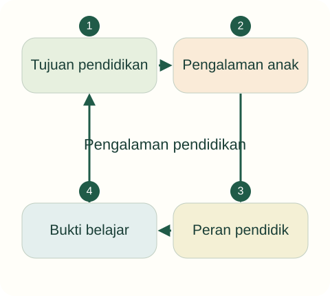

### Kasus ilustratif

Kapan kegiatan sehari-hari menjadi pengalaman pendidikan?

Di satu kelas, anak mengerjakan lembar yang meminta mereka memasangkan gambar dengan jumlah benda. Di kelas lain, anak membantu menyiapkan meja. Seorang anak menaruh dua piring di satu tempat, lalu guru bertanya bagaimana memastikan setiap teman mendapat satu piring.

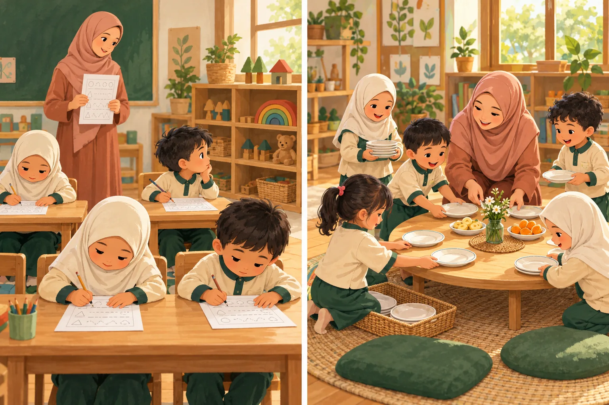

### Pembahasan

Pada kedua adegan anak mungkin mempelajari hubungan satu lawan satu. Bandingkan apa yang dilakukan anak sendiri. Pada lembar tugas, anak dapat menjelaskan alasan memasangkan gambar. Saat menyiapkan meja, anak dapat menemukan dan memperbaiki pembagian yang belum merata. Catat ucapan atau tindakan yang menunjukkan strategi anak pada masing-masing kegiatan.

### Latihan terbimbing

Uraikan kegiatan cuci tangan. Mulai dari tersedianya sabun dan bantuan untuk anak, lalu identifikasi tindakan mengajar, latihan yang diulang, dan tujuan pendidikan yang dapat diupayakan.

### Latihan mandiri

Pilih satu rutinitas RA. Dalam 150–200 kata, bedakan tiga istilah dari materi dan usulkan satu bukti bahwa anak mulai memahami tindakan yang dilakukannya.

### Refleksi

Kegiatan mana yang pernah saya nilai berhasil dari hasil akhir saja? Bukti apa yang akan saya cari sekarang?

### Referensi

- Republik Indonesia. (2003). Undang-Undang Nomor 20 Tahun 2003 tentang Sistem Pendidikan Nasional. https://peraturan.bpk.go.id/Details/43920/uu-no-20-tahun-2003

- Dewey, J. (1997). Experience and education. Touchstone. (Original work published 1938) https://www.simonandschuster.com/books/Experience-And-Education/John-Dewey/9780684838281

- Sujiono, Y. N. (2009). Konsep dasar pendidikan anak usia dini. Indeks. https://opac.uma.ac.id/index.php?id=14771&keywords=&p=show_detail

## 2. Manusia sebagai subjek pendidikan

Menjelaskan mengapa manusia dapat dan perlu dididik dengan tetap mengakui keaktifan anak.

### Tujuan

- Membedakan dapat dididik dan perlu dididik

- Menjelaskan peran anak dan kondisi lingkungan

- Mengusulkan bantuan yang menjaga kesempatan anak mengambil keputusan

### Dapat dan perlu dididik

Dapat dididik menunjuk pada kemungkinan manusia berubah melalui pengalaman dan bimbingan. Perlu dididik menunjuk pada ketergantungan manusia pada hubungan sosial untuk memasuki dunia bahasa, nilai, dan pengetahuan bersama. Anak membawa keadaan tubuh, minat, dan riwayat pengalaman yang beragam. Kemampuan yang mulai tumbuh terlihat dari apa yang dapat ia lakukan dalam keadaan tertentu. Pernyataan “ia belum ikut bercerita ketika berada di kelompok besar” memberi dasar tindakan yang lebih baik daripada sebutan “anak ini pasif”.

### Pengalaman terbentuk dalam interaksi

Dewey (1938/1997) menempatkan pengalaman pada pertemuan antara anak dan kondisi lingkungannya. Balok lebar membuka kemungkinan baru, tetapi anak tetap perlu memilih, menguji, dan membaca hasilnya. Bronfenbrenner (1979) memperluas perhatian ke lingkungan anak, termasuk kegiatan dan hubungan di rumah serta satuan pendidikan. Informasi keluarga dapat membantu guru memahami kapan seorang anak banyak berbicara atau benda apa yang akrab baginya. Pengetahuan itu dipakai untuk merancang kesempatan yang lebih sesuai.

### Anak sebagai subjek

Anak disebut subjek pendidikan karena ia mengalami, menafsirkan, dan ikut mengarahkan tindakannya. Partisipasi dapat muncul melalui ucapan, isyarat, pilihan, atau penolakan. Konvensi Hak Anak memberi landasan untuk mempertimbangkan pandangan anak sesuai usia dan kematangannya. Pendidik tetap memegang tanggung jawab menjaga keselamatan dan menjelaskan batas. Pada permainan balok, anak dapat memilih cara menyusun. Guru dapat membatasi tinggi bangunan jika ada risiko menimpa teman.

### Perbedaan perkembangan dan belajar sepanjang hayat

Pedoman praktik sesuai perkembangan dari NAEYC (2020) mempertimbangkan pola umum perkembangan, keunikan anak, serta konteks sosial dan budaya. Tiga pertimbangan ini membantu guru memilih dukungan awal dan meninjaunya setelah melihat respons anak. Begitu pula ketika orang dewasa mempelajari cara baru mendidik, pengalaman sebelumnya menjadi bekal dan dapat berubah melalui latihan serta refleksi. Usia dini memberi dasar penting bagi pengalaman berikutnya. Pengaruhnya tetap berlangsung bersama kesempatan belajar yang tersedia sepanjang hidup.

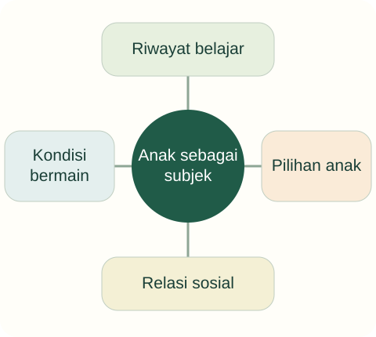

### Kasus ilustratif

Jika anak memiliki potensi, mengapa ia masih memerlukan pendidikan?

Saat membangun menara, Aira beberapa kali memilih balok kecil sebagai alas. Setelah menaranya jatuh ia memperhatikan temannya memakai balok lebar. Guru menyediakan dua pilihan alas dan memberi waktu kepada Aira untuk mencoba.

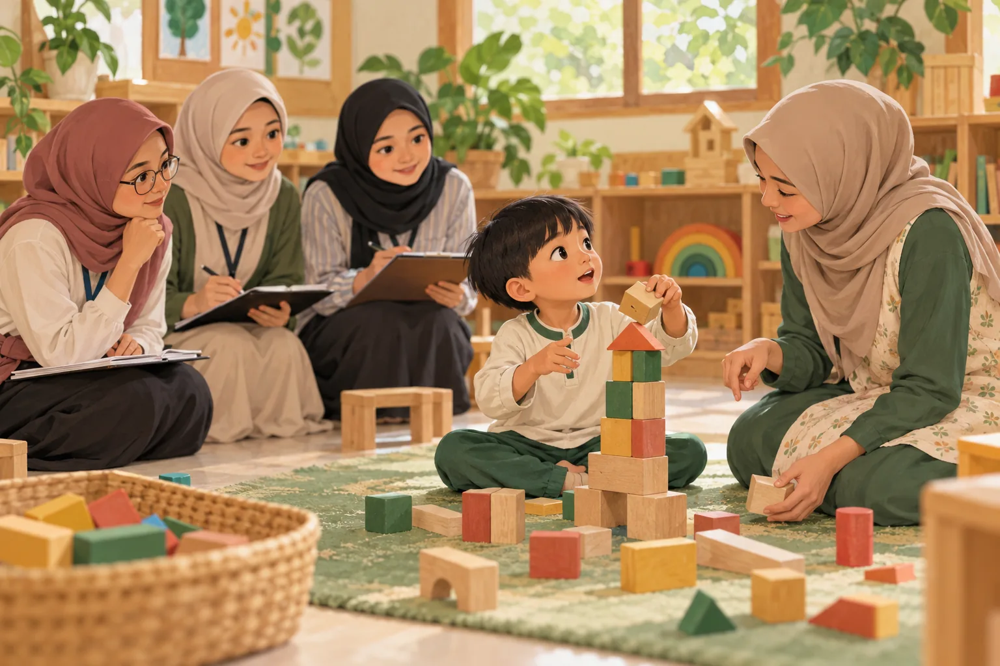

### Pembahasan

Jatuhnya menara menunjukkan hasil dari satu susunan. Pilihan alas, pengamatan terhadap teman, dan percobaan ulang memperlihatkan bagaimana Aira ikut membentuk pengalamannya. Tanyakan apa yang ia perhatikan, lalu amati apakah pilihannya berubah pada bangunan berikutnya.

### Latihan terbimbing

Ubah pernyataan “anak ini tidak mandiri” menjadi catatan netral tentang satu peristiwa memakai sepatu. Tulis tindakan yang ia mulai sendiri, bantuan yang ia minta, dan kesempatan mencoba berikutnya.

### Latihan mandiri

Seorang anak berbicara lancar di rumah dan jarang berbicara di kelas. Ajukan dua penjelasan yang dapat diperiksa dan satu cara memperluas partisipasinya.

### Refleksi

Keputusan apa yang dapat saya serahkan kepada anak dengan tetap menjaga keselamatannya?

### Referensi

- Dewey, J. (1997). Experience and education. Touchstone. (Original work published 1938) https://www.simonandschuster.com/books/Experience-And-Education/John-Dewey/9780684838281

- Bronfenbrenner, U. (1979). The ecology of human development: Experiments by nature and design. Harvard University Press. https://www.jstor.org/stable/j.ctv26071r6

- National Association for the Education of Young Children. (2020). Developmentally appropriate practice: A position statement. https://www.naeyc.org/resources/position-statements/dap/contents

- United Nations. (1989). Convention on the Rights of the Child. https://www.ohchr.org/sites/default/files/crc.pdf

## 3. Tujuan dan fungsi pendidikan

Menurunkan tujuan pendidikan menjadi pengalaman dan bukti perkembangan.

### Tujuan

- Membedakan tujuan, fungsi, hasil, dan indikator

- Menggunakan tiga fungsi pendidikan menurut Biesta

- Merumuskan bukti sesuai tujuan

### Tujuan, fungsi, dan hasil

Tujuan menyatakan arah yang hendak dicapai. Fungsi menjelaskan peranan pendidikan bagi individu dan kehidupan bersama. Hasil menerangkan perubahan yang sungguh teramati. Kegiatan adalah sarana menuju tujuan dan indikator adalah petunjuk yang membantu membaca hasil. Dalam bermain pasar, kegiatan membeli dua buah dapat mendukung tujuan memasangkan jumlah dengan benda. Salah satu indikatornya ialah anak memilih dua buah saat diminta, termasuk ketika buah diletakkan dalam susunan yang berbeda.

### Tiga fungsi pendidikan menurut Biesta

Biesta (2009) membedakan kualifikasi, sosialisasi, dan subjektifikasi. Kualifikasi berhubungan dengan pengetahuan dan kecakapan, misalnya menggunakan bilangan untuk membagi benda. Sosialisasi berhubungan dengan masuk ke dalam praktik dan aturan bersama, misalnya memahami giliran. Subjektifikasi memberi perhatian pada kemungkinan seseorang bertindak sebagai subjek yang punya pertimbangan dan tanggung jawab. Pada situasi giliran, anak dapat mengusulkan memakai keranjang secara bergantian karena memahami temannya juga membutuhkannya. Ketiganya bisa hadir bersama dan kadang menarik kegiatan ke arah berbeda. Pembagian Biesta dipakai untuk menimbang tujuan, bukan sebagai skala pengukuran anak.

### Dari tujuan nasional ke kelas PAUD

Pasal 3 UU No. 20 Tahun 2003 memberi arah pengembangan kemampuan dan pembentukan watak dalam kehidupan bersama. Permendikdasmen No. 10 Tahun 2025 dan No. 12 Tahun 2025 memberi rujukan standar yang perlu dibaca pada bagian PAUD. Di kelas, tujuan yang luas seperti tanggung jawab perlu diterjemahkan ke keadaan yang dapat dipahami anak. Guru dapat menyiapkan alat bersama, menentukan tempat pengembalian, dan memperhatikan apakah anak merawat alat yang dipakai dengan bantuan yang berangsur disesuaikan.

### Memilih bukti yang sepadan

Kartu huruf memberi informasi tentang pengenalan lambang tertentu. Bukti tentang bahasa juga dapat diperoleh dari percakapan, cerita ulang, dan penggunaan tulisan dalam permainan. Untuk tujuan menyelesaikan konflik, amati cara anak menyatakan keinginan, mendengar usulan, atau menerima bantuan. Hasil satu kegiatan bersifat terbatas. Catatan pada beberapa kesempatan membantu guru membedakan respons sesaat dari perkembangan yang mulai terlihat.

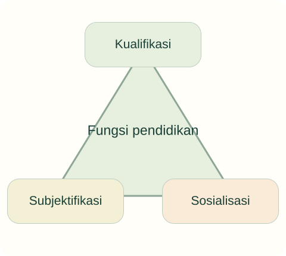

### Kasus ilustratif

Apa yang hilang jika mutu RA dinilai dari kelancaran membaca saja?

Sebuah RA memakai kemampuan menyebut huruf sebagai tolok ukur utama. Di kelas, seorang anak cepat mengenali kartu huruf. Ketika dua anak ingin memakai keranjang yang sama, guru melihat salah satunya belum dapat meminta giliran.

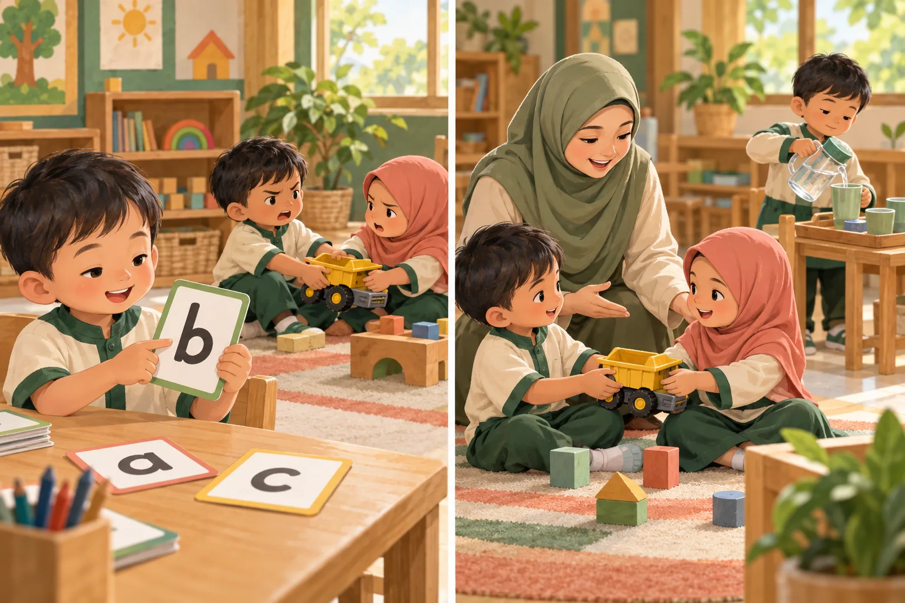

### Pembahasan

RA dapat tetap mencatat pengenalan huruf dan menambah bukti yang langsung terkait dengan tujuan sosial. Pada kasus keranjang, ucapan “boleh aku pakai setelah kamu?” memberi informasi yang berbeda dari jawaban benar pada kartu huruf. Keduanya membantu guru menentukan pengalaman berikutnya.

### Latihan terbimbing

Ubah “anak menyelesaikan dua lembar kerja” menjadi tujuan belajar yang spesifik. Beri satu contoh pengalaman dan satu indikator yang langsung sesuai dengan tujuan.

### Latihan mandiri

Jelaskan kepada keluarga dalam dua paragraf bagaimana satu kegiatan bermain dapat membawa dua tujuan berbeda. Beri satu bukti untuk setiap tujuan.

### Refleksi

Bukti apa yang mudah dicatat di kelas tetapi hanya mencakup bagian kecil dari tujuan pendidikan?

### Referensi

- Republik Indonesia. (2003). Undang-Undang Nomor 20 Tahun 2003 tentang Sistem Pendidikan Nasional. https://peraturan.bpk.go.id/Details/43920/uu-no-20-tahun-2003

- Biesta, G. (2009). Good education in an age of measurement: On the need to reconnect with the question of purpose in education. Educational Assessment, Evaluation and Accountability, 21, 33–46. https://doi.org/10.1007/s11092-008-9064-9

- Kementerian Pendidikan Dasar dan Menengah. (2025). Peraturan Menteri Pendidikan Dasar dan Menengah Nomor 10 Tahun 2025 tentang Standar Kompetensi Lulusan pada Pendidikan Anak Usia Dini, Jenjang Pendidikan Dasar, dan Jenjang Pendidikan Menengah. https://peraturan.go.id/id/permendikdasmen-no-10-tahun-2025

- Kementerian Pendidikan Dasar dan Menengah. (2025). Peraturan Menteri Pendidikan Dasar dan Menengah Nomor 12 Tahun 2025 tentang Standar Isi pada Pendidikan Anak Usia Dini, Jenjang Pendidikan Dasar, dan Jenjang Pendidikan Menengah. https://jdih.kemendikdasmen.go.id/sjdih/siperpu/dokumen/salinan/Permendikdasmen_No_12_Tahun_2025_ttg_Standar_Isi_pada_Pe.pdf

## 4. Landasan pendidikan

Membedakan dasar filosofis, psikologis, sosial budaya, religius, dan yuridis dalam satu keputusan.

### Tujuan

- Membedakan lima landasan pendidikan

- Mengenali jenis klaim dalam alasan guru

- Merumuskan respons berlandaskan tujuan, konteks, dan ketentuan

### Landasan filosofis dan religius

Landasan filosofis, termasuk pertanyaan tentang mutu pengalaman yang diajukan Dewey (1938/1997), memeriksa pandangan tentang manusia, pengetahuan, dan nilai. Jika pendidikan diarahkan pada tanggung jawab, guru perlu memberi ruang bagi anak memahami akibat tindakannya dan ikut memperbaiki keadaan. Landasan religius memberi orientasi makna dan nilai dalam tradisi keimanan. Dalam PIAUD, nasihat Luqman pada Al-Qur’an 31:13–19 dapat menjadi bahan telaah tentang tanggung jawab, kesabaran, dan cara memperlakukan orang lain. Implikasi pedagogisnya disusun melalui penalaran guru dengan memperhatikan kemampuan anak.

### Landasan psikologis

Landasan psikologis memberi penjelasan tentang cara anak berkembang dan belajar. Pada konflik, guru dapat memeriksa apakah anak siap mendengar pertanyaan, memahami urutan peristiwa, dan memiliki kata-kata untuk menyampaikan maksud. NAEYC (2020) memberi kerangka profesional untuk mempertimbangkan pola perkembangan, individualitas, dan konteks. Klaim bahwa mempermalukan anak akan membuatnya lebih bertanggung jawab perlu diperiksa dengan bukti yang relevan. Perilaku terhenti sesaat dapat menunjukkan bahwa situasi sudah berubah, sedangkan pemahaman perlu diamati pada kesempatan berikutnya.

### Landasan sosial budaya

Anak membawa kebiasaan bahasa, cara menyapa, dan pengalaman menyelesaikan persoalan dari lingkungan. Di satu keluarga anak terbiasa menyampaikan alasan langsung. Di keluarga lain anak menunggu ditanya. Guru dapat memakai pengetahuan ini untuk memberi kesempatan bicara yang lebih adil tanpa menetapkan karakter anak dari latar keluarganya. Telaah sosial budaya juga menanyakan siapa yang terbiasa didengar dan siapa yang jarang memperoleh giliran.

### Landasan yuridis dan cara menggunakan landasan

Landasan yuridis menetapkan hak, kewajiban, dan batas yang mengikat. UU Perlindungan Anak memberi dasar untuk menjaga anak dari kekerasan di satuan pendidikan. Standar proses memberi acuan mengenai penyelenggaraan pembelajaran. Ketentuan tersebut perlu dibaca sesuai ruang lingkupnya. Dalam satu keputusan, hukum membatasi tindakan, tujuan memberi arah, pengetahuan tentang perkembangan membantu memilih bahasa, dan konteks sosial membantu guru memahami respons. Catatan sesudah kegiatan memberi informasi untuk meninjau keputusan.

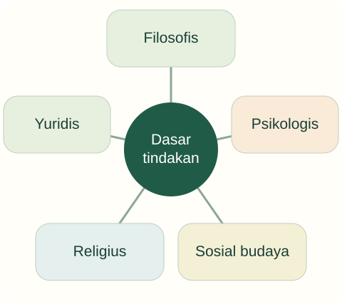

### Kasus ilustratif

Atas dasar apa guru memilih cara menanggapi konflik?

Menara balok roboh setelah dua anak menarik alasnya. Guru pertama ingin meminta salah satu anak berdiri di depan kelompok dan mengaku salah. Guru kedua ingin mendengar kedua anak dan membantu mereka memperbaiki bangunan.

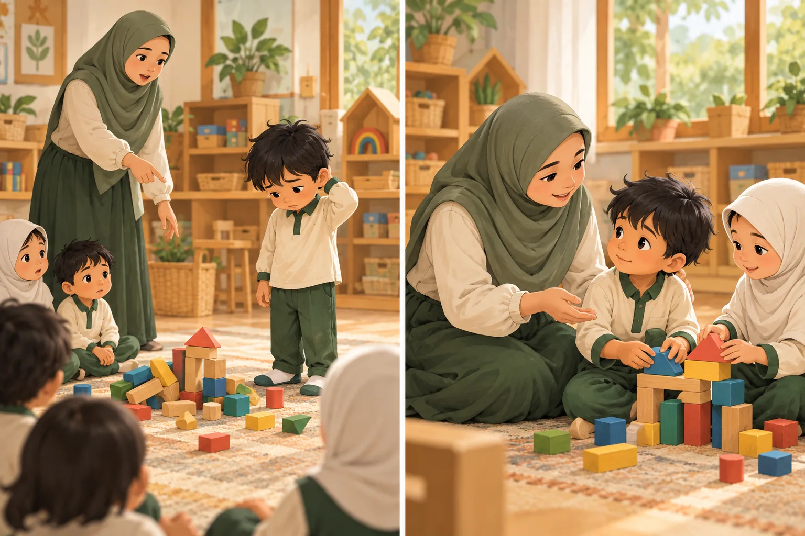

### Pembahasan

Guru dapat mengamankan balok yang berserakan, mendengar urutan kejadian dari kedua anak, dan mengajak mereka menentukan cara memperbaiki susunan. Cara tersebut memberi kesempatan berlatih tanggung jawab. Pada penggunaan balok berikutnya, guru dapat mengamati apakah kedua anak mulai menyatakan maksud sebelum menarik bagian bangunan.

### Latihan terbimbing

Telaah kalimat “anak harus meminta maaf supaya jera”. Tandai bagian yang menyatakan nilai atau tujuan dan bagian yang memprediksi akibat tindakan. Tulis jenis bukti yang diperlukan untuk memeriksa prediksi.

### Latihan mandiri

Tulis respons guru terhadap konflik balok dengan satu alasan filosofis, satu pertimbangan psikologis, dan satu batas yuridis. Jelaskan peran masing-masing alasan.

### Refleksi

Landasan apa yang biasa saya gunakan saat memilih aturan kelas? Informasi apa yang masih perlu saya periksa?

### Referensi

- Dewey, J. (1997). Experience and education. Touchstone. (Original work published 1938) https://www.simonandschuster.com/books/Experience-And-Education/John-Dewey/9780684838281

- National Association for the Education of Young Children. (2020). Developmentally appropriate practice: A position statement. https://www.naeyc.org/resources/position-statements/dap/contents

- Al-Qur’an. Surah Luqman (31), ayat 13–19. https://quran.com/id/luqman/13-19

- Republik Indonesia. (2014). Undang-Undang Nomor 35 Tahun 2014 tentang Perubahan atas Undang-Undang Nomor 23 Tahun 2002 tentang Perlindungan Anak. https://peraturan.bpk.go.id/Details/38723/uu-no-35-tahun-2014

- Kementerian Pendidikan Dasar dan Menengah. (2026). Peraturan Menteri Pendidikan Dasar dan Menengah Nomor 1 Tahun 2026 tentang Standar Proses pada Pendidikan Anak Usia Dini, Jenjang Pendidikan Dasar, dan Jenjang Pendidikan Menengah. https://peraturan.bpk.go.id/Details/344196/permendikdasmen-no-1-tahun-2026

## 5. Pemikiran pendidikan dan implikasinya

Membandingkan Dewey, Piaget, Vygotsky, dan Ki Hadjar Dewantara melalui satu persoalan.

### Tujuan

- Menjelaskan gagasan spesifik empat tokoh

- Menurunkan implikasi dari teori pada satu masalah

- Membedakan zona perkembangan proksimal dan scaffolding

### Dewey dan penyelidikan melalui pengalaman

Dewey (1938/1997) menilai pengalaman dari interaksinya dengan kondisi anak serta kesinambungannya ke pengalaman berikutnya. Kegagalan jembatan menimbulkan masalah yang dapat diselidiki. Guru dapat bertanya apa yang menyebabkan balok jatuh, menyiapkan beberapa ukuran, dan mengajak anak mencoba lagi pada celah berbeda. Penyelidikan memberi arah pada pengalaman. Anak memperoleh kesempatan menghubungkan tindakan dengan akibat dan menggunakan temuan sebelumnya.

### Piaget dan perubahan skema

Dalam pemikiran Piaget, skema ialah pola bertindak atau memahami yang dipakai untuk menghadapi situasi. Asimilasi terjadi ketika anak menangani situasi dengan pola yang sudah ia punya. Akomodasi terjadi ketika pola disesuaikan karena cara lama belum memadai. Jika anak sebelumnya menempatkan balok apa saja lalu mulai memilih balok yang melewati kedua tepi celah, guru memperoleh petunjuk tentang perubahan strategi. Pengamatan sederhana ini tidak menetapkan tahap perkembangan anak. Perhatikan apakah ia menggunakan strategi tersebut kembali.

### Vygotsky dan bantuan dalam kegiatan bersama

Vygotsky (1978) memakai zona perkembangan proksimal untuk menjelaskan jarak antara kemampuan memecahkan masalah secara mandiri dan kemampuan dengan bimbingan orang dewasa atau kerja sama dengan teman yang lebih mampu. Wood, Bruner, dan Ross (1976) memperkenalkan scaffolding dalam pembahasan tentang bantuan tutor pada pemecahan masalah. Petunjuk yang membantu anak melakukan langkah yang semula sulit dapat dikurangi ketika anak mulai menguasainya. Untuk mengetahui apa yang berubah, amati tindakan mandiri awal, respons saat dibantu, dan tindakan setelah bantuan dikurangi.

### Ki Hadjar Dewantara dan tuntunan

Dalam sistem Among, pendidik menuntun perkembangan dengan memberi ruang kemerdekaan yang disertai tanggung jawab. Guru dapat memberi teladan ketika diperlukan, membangun prakarsa ketika bekerja bersama anak, dan memberi dorongan saat anak mengambil langkah sendiri. Pada jembatan balok, tuntunan berarti menjaga ruang mencoba sambil menyediakan dukungan yang wajar. Dewey membantu menilai mutu pengalaman, Piaget membantu membaca perubahan strategi, Vygotsky mengarahkan perhatian pada bantuan sosial, dan Among memberi dasar etis bagi cara guru menuntun.

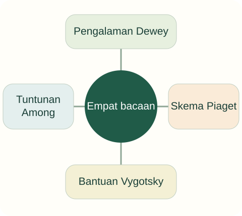

### Kasus ilustratif

Apa yang perlu dilakukan guru ketika anak menghadapi kesulitan?

Anak mencoba menjembatani dua tumpukan dengan balok pendek. Guru dapat menyelesaikannya, memberi waktu anak menguji beberapa balok, atau memberi petunjuk agar anak membandingkan panjang balok dengan celah.

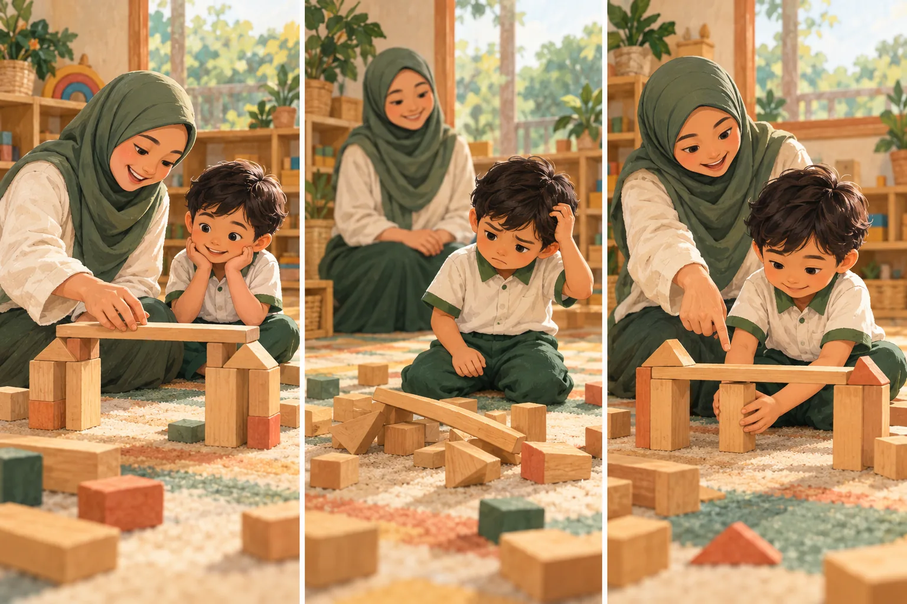

### Pembahasan

Mulailah dari tindakan anak. Saat ia belum menemukan hubungan panjang dan celah, guru dapat bertanya apakah ujung balok menyentuh kedua sisi. Jika petunjuk membantu, beri celah baru dan lihat apa yang dikerjakan tanpa petunjuk. Catatan ini berguna untuk menjelaskan bantuan dan perubahan strategi secara terpisah.

### Latihan terbimbing

Lengkapi tiga baris catatan: tindakan mandiri, tindakan setelah satu petunjuk, dan percobaan baru. Jelaskan bagian yang dapat dibaca melalui Vygotsky dan bagian yang dapat dibaca melalui Piaget.

### Latihan mandiri

Bandingkan dua respons guru pada permainan susun bentuk. Gunakan dua tokoh dan tunjukkan bagaimana setiap gagasan menghasilkan alasan tindakan yang berbeda.

### Refleksi

Pada titik mana bantuan saya mulai mengambil alih kegiatan anak?

### Referensi

- Dewey, J. (1997). Experience and education. Touchstone. (Original work published 1938) https://www.simonandschuster.com/books/Experience-And-Education/John-Dewey/9780684838281

- Fondation Jean Piaget. (n.d.). Les processus d’adaptation et d’organisation. https://www.fondationjeanpiaget.ch/fjp/site/ModuleFJP001/index_gen_page.php?IDMODULE=72&IDPAGE=394

- Vygotsky, L. S. (1978). Mind in society: The development of higher psychological processes (M. Cole, V. John-Steiner, S. Scribner, & E. Souberman, Eds.). Harvard University Press. https://www.jstor.org/stable/j.ctvjf9vz4

- Wood, D., Bruner, J. S., & Ross, G. (1976). The role of tutoring in problem solving. Journal of Child Psychology and Psychiatry, 17(2), 89–100. https://doi.org/10.1111/j.1469-7610.1976.tb00381.x

- Direktorat Jenderal Kebudayaan. (2017). Mengenal sistem Among dalam konsep belajar Taman Siswa. https://kebudayaan.kemdikbud.go.id/mengenal-sistem-among-dalam-konsep-belajar-taman-siswa/

## 6. Komponen dan proses pendidikan

Merancang hubungan antara tujuan, pengalaman, peran pendidik, dan asesmen.

### Tujuan

- Memetakan komponen dalam proses pendidikan

- Memeriksa keselarasan tujuan, kegiatan, dan asesmen

- Menggunakan pengamatan untuk menyesuaikan bantuan

### Komponen bekerja sebagai satu sistem

Komponen pendidikan meliputi pendidik, peserta didik, tujuan, isi, metode, lingkungan, serta asesmen. Komponen ini saling memengaruhi. Tujuan mengenali hubungan letak, misalnya, perlu didukung oleh isi berupa konsep dekat, jauh, dan di antara. Metode dengan balok memberi peluang memindahkan benda dan membandingkan letak. Ruang kelas perlu menyediakan tempat untuk melihat perubahan susunan. Keberhasilan sistem bergantung pada hubungan antarkomponen tersebut.

### Perencanaan dimulai dari kemampuan yang dituju

Permendikdasmen No. 1 Tahun 2026 memberi rujukan mengenai perencanaan, pelaksanaan, dan penilaian proses pembelajaran. Dalam rancangan kelas, tujuan memberi alasan memilih kegiatan. Untuk mengembangkan bahasa ruang, guru dapat meminta anak menempatkan pasar di antara dua rumah lalu menjelaskan letaknya. Jika tujuan utamanya mengombinasikan warna, kegiatan mewarnai dapat dipakai dengan pilihan dan umpan balik yang sesuai. Kegiatan yang sama dapat mendukung tujuan berbeda ketika tuntutan dan bantuan diubah.

### Asesmen formatif mengubah tindakan berikutnya

Black dan Wiliam (1998) menempatkan penggunaan informasi untuk menyesuaikan pengajaran dan belajar sebagai ciri kerja formatif. Guru mendengar anak mengatakan “di samping” saat menempatkan pasar “di antara”. Catatan itu dapat ditindaklanjuti dengan membandingkan dua susunan dan meminta anak menunjukkan perbedaannya. Permendikbudristek No. 21 Tahun 2022 memberi rujukan mengenai penilaian hasil belajar. Bedakan pengamatan terhadap perkembangan anak dari penilaian terhadap bagaimana pendidik melaksanakan proses pembelajaran.

### Meninjau rancangan dari akses anak

Ketika hanya satu anak memindahkan balok, hasil kelompok memberi informasi terbatas tentang partisipasi setiap anak. Guru dapat menyiapkan peran yang bergilir, menyediakan benda yang mudah diraih, dan memberi kesempatan menjawab dengan menunjuk atau berbicara. Sesudah kegiatan, guru memeriksa siapa yang menggunakan konsep secara mandiri dan siapa yang berpartisipasi setelah diberi contoh. Informasi itu dipakai untuk memilih bantuan berikutnya.

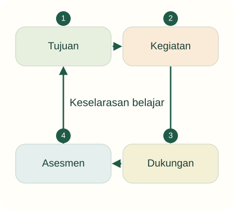

### Kasus ilustratif

Bagaimana mengetahui bahwa rancangan kegiatan benar-benar memberi kesempatan belajar?

Setelah melihat gambar kota, anak diminta mewarnai bangunan pada lembar masing-masing. Guru lain memakai gambar yang sama untuk mengajak kelompok menyusun kota balok dan menghubungkan rumah dengan pasar.

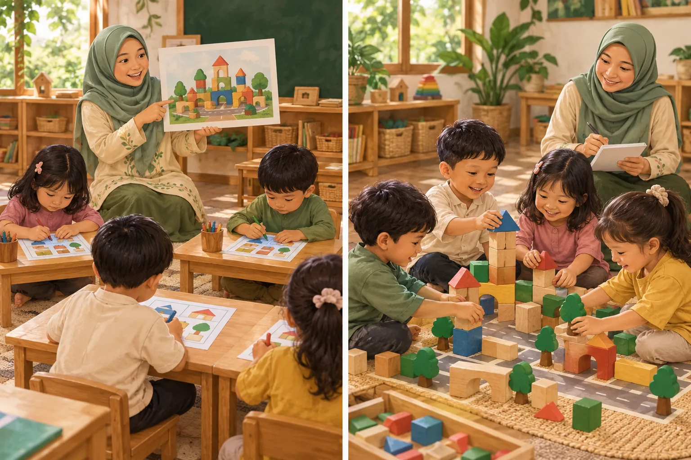

### Pembahasan

Jika tujuannya memahami letak, kegiatan kota balok dapat dipakai untuk mengamati tindakan setiap anak. Beri satu instruksi untuk menempatkan benda, pertanyaan tentang alasannya, dan satu susunan baru untuk menguji penerapan.

### Latihan terbimbing

Lengkapi urutan untuk kegiatan kota balok: tujuan, isi, tindakan anak, alat, dan bukti. Tentukan perubahan bantuan bila anak masih tertukar antara “di samping” dan “di antara”.

### Latihan mandiri

Ambil satu kegiatan PAUD. Jelaskan satu ketidakselarasan antarkomponen, lalu perbaiki rancangan dan tunjukkan cara mengeceknya.

### Refleksi

Bagaimana catatan saya hari ini akan mengubah kegiatan besok?

### Referensi

- Kementerian Pendidikan Dasar dan Menengah. (2026). Peraturan Menteri Pendidikan Dasar dan Menengah Nomor 1 Tahun 2026 tentang Standar Proses pada Pendidikan Anak Usia Dini, Jenjang Pendidikan Dasar, dan Jenjang Pendidikan Menengah. https://peraturan.bpk.go.id/Details/344196/permendikdasmen-no-1-tahun-2026

- Kementerian Pendidikan, Kebudayaan, Riset, dan Teknologi. (2022). Peraturan Menteri Pendidikan, Kebudayaan, Riset, dan Teknologi Nomor 21 Tahun 2022 tentang Standar Penilaian Pendidikan pada Pendidikan Anak Usia Dini, Jenjang Pendidikan Dasar, dan Jenjang Pendidikan Menengah. https://peraturan.bpk.go.id/Details/224425/permendikbudriset-no-21-tahun-2022

- Black, P., & Wiliam, D. (1998). Assessment and classroom learning. Assessment in Education: Principles, Policy & Practice, 5(1), 7–74. https://doi.org/10.1080/0969595980050102

## 7. Lingkungan dan pusat pendidikan

Menjelaskan hubungan rumah, satuan pendidikan, dan masyarakat melalui trisentra dan ekologi perkembangan.

### Tujuan

- Membedakan trisentra pendidikan dan jalur pendidikan

- Mengidentifikasi lingkungan langsung dan hubungan antarlingkungan

- Merancang kemitraan yang terjangkau keluarga

### Pusat pendidikan dan jalur pendidikan

Gagasan trisentra dari Ki Hadjar Dewantara membantu melihat alam keluarga, perguruan, dan pergerakan pemuda sebagai tempat yang saling mendukung dalam pendidikan. Dalam penerapan saat ini, gagasan tersebut dapat dibaca melalui peran keluarga, satuan pendidikan, dan masyarakat. Pasal 13 UU No. 20 Tahun 2003 membedakan jalur formal, nonformal, dan informal. Jalur merupakan kategori penyelenggaraan. Keluarga memberi pengalaman informal sehari-hari, sementara masyarakat juga dapat menyelenggarakan layanan nonformal. Kedua kerangka dipakai untuk menjawab pertanyaan berbeda.

### Mikrosistem dan mesosistem

Dalam ekologi perkembangan Bronfenbrenner (1979), mikrosistem adalah lingkungan tempat anak terlibat langsung melalui kegiatan, peran, dan hubungan. Rumah bersama nenek serta kelompok bermain di satuan PAUD merupakan dua contoh. Mesosistem menunjuk hubungan di antara lingkungan langsung itu. Ketika keluarga dan guru bertukar informasi tentang istilah tanaman, hubungan kedua lingkungan dapat memperluas kesempatan anak bercerita. Pengaruh lingkungan yang lebih luas juga dapat muncul secara tidak langsung, misalnya jadwal kerja pengasuh mengubah peluang bertemu guru.

### Proses, pribadi, konteks, dan waktu

Model bioekologis Bronfenbrenner dan Morris (2006) memberi perhatian pada proses proksimal, yaitu interaksi timbal balik yang berulang dengan orang, benda, atau simbol di lingkungan dekat. Analisisnya juga mempertimbangkan karakteristik orang, konteks, dan waktu. Membawa satu gambar memberi kesempatan untuk membuka percakapan. Untuk menelaah proses yang berlangsung, lihat bagaimana anak dan orang dewasa berulang kali bertukar pertanyaan, pengalaman, dan cara menyelidiki tanaman.

### Hubungan dengan keluarga perlu dirancang

Guru dapat mengundang cerita atau gambar tanpa mewajibkan keluarga membeli bahan atau datang pada jam kerja. Anak dapat menggunakan istilah dari rumah, lalu belajar padanannya ketika berkomunikasi dengan teman. Informasi dibagikan sesuai kebutuhan pendidikan dan dengan menghormati privasi keluarga. Kemitraan kemudian dinilai dari kualitas pertukaran dan peluang yang diperoleh anak.

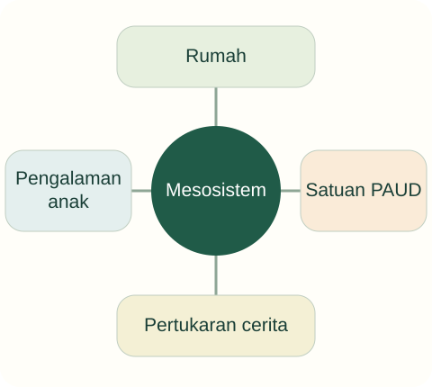

### Kasus ilustratif

Apa yang berubah ketika pengalaman rumah dan satuan PAUD saling terhubung?

Anak berbincang dengan nenek tentang daun di sekitar rumah. Keesokan hari ia membawa gambar daun ke satuan PAUD. Nenek bercerita kepada guru bahwa anak biasa menyebut tanaman itu dalam bahasa keluarganya.

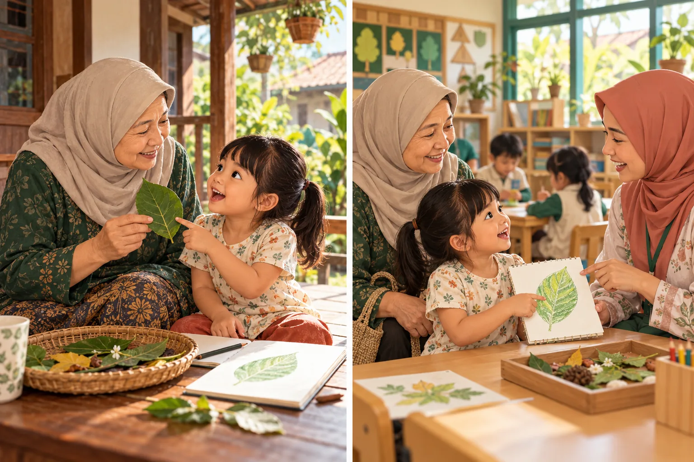

### Pembahasan

Guru dapat mengajak anak membandingkan bentuk daun, meminta ia menjelaskan sebutan yang dipakai di rumah, dan mengundang keluarga menambahkan informasi bila memungkinkan. Bukti awalnya ialah apakah pengetahuan dari rumah dipakai dalam percakapan kelas.

### Latihan terbimbing

Buat peta rumah, kelompok PAUD, dan taman setempat. Tandai dua lingkungan yang dialami langsung anak dan jelaskan satu hubungan di antara keduanya.

### Latihan mandiri

Rancang komunikasi sekolah–keluarga untuk satu kegiatan observasi lingkungan. Sertakan cara berpartisipasi bagi keluarga yang memiliki akses internet atau waktu terbatas.

### Refleksi

Pengetahuan keluarga apa yang selama ini belum terhubung dengan pengalaman belajar di kelas?

### Referensi

- Republik Indonesia. (2003). Undang-Undang Nomor 20 Tahun 2003 tentang Sistem Pendidikan Nasional. https://peraturan.bpk.go.id/Details/43920/uu-no-20-tahun-2003

- Kementerian Pendidikan, Kebudayaan, Riset, dan Teknologi. (2022). Panduan implementasi bimbingan dan konseling untuk jenjang pendidikan dasar dan menengah. https://kurikulum.kemendikdasmen.go.id/wp-content/uploads/2022/09/V6.-Panduan-BK.pdf

- Bronfenbrenner, U. (1979). The ecology of human development: Experiments by nature and design. Harvard University Press. https://www.jstor.org/stable/j.ctv26071r6

- Bronfenbrenner, U., & Morris, P. A. (2006). The bioecological model of human development. In R. M. Lerner (Ed.), Handbook of child psychology: Vol. 1. Theoretical models of human development (6th ed., pp. 793–828). Wiley. https://doi.org/10.1002/9780470147658.chpsy0114

## 9. PAUD dalam sistem pendidikan nasional

Membedakan jalur layanan, kedudukan RA, dan pengembangan anak usia dini holistik-integratif.

### Tujuan

- Menjelaskan kedudukan layanan PAUD dan RA

- Membedakan standar, kurikulum, dan koordinasi PAUD HI

- Merancang pembagian peran untuk kasus satu anak

### PAUD sebagai upaya pembinaan

UU No. 20 Tahun 2003 Pasal 1 angka 14 menempatkan PAUD pada rentang sejak lahir sampai usia enam tahun. Pasal 28 menerangkan kedudukannya sebelum pendidikan dasar serta penyelenggaraan melalui jalur formal, nonformal, dan informal. Pada jalur formal terdapat TK, RA, atau bentuk lain yang sederajat. Kelompok Bermain dan Taman Penitipan Anak termasuk bentuk nonformal, sedangkan pendidikan keluarga atau yang diselenggarakan oleh lingkungan termasuk jalur informal.

### Standar nasional, kurikulum, dan RA

Standar nasional memberi kriteria penyelenggaraan. Kurikulum mengatur arah dan kerangka pembelajaran. Untuk PAUD, baca standar kompetensi lulusan dan standar isi sesuai lingkup PAUD, serta dokumen capaian pembelajaran yang relevan. Untuk RA, pedoman implementasi kurikulum Kementerian Agama dibaca secara khusus, termasuk KMA No. 450 Tahun 2024 sebagaimana diubah melalui KMA No. 1503 Tahun 2025. Pemilihan dokumen dimulai dengan memastikan satuan, jalur, lingkup, dan ketentuan yang sedang dirujuk.

### Holistik-integratif sebagai koordinasi

Perpres No. 60 Tahun 2013 tentang Pengembangan Anak Usia Dini Holistik-Integratif mengarahkan pemenuhan kebutuhan esensial anak secara terpadu. Dimensi layanan meliputi pendidikan, kesehatan dan gizi, pengasuhan, perlindungan, dan kesejahteraan. Holistik melihat kebutuhan anak sebagai satu kesatuan. Integratif menghubungkan pihak yang memiliki mandat berbeda. Guru mengamati partisipasi dan kebutuhan belajar, keluarga menyampaikan informasi yang relevan, dan tenaga kesehatan melakukan pemeriksaan sesuai kewenangan.

### Menerjemahkan kebijakan ke praktik

Guru dapat mencatat kapan anak tampak lelah, kegiatan yang tetap menarik minatnya, dan penyesuaian yang membantu partisipasinya. Keluarga dan pihak yang berwenang dapat membahas dukungan dengan menghormati kerahasiaan. Kebijakan memberi kerangka kerja, sedangkan keputusan kelas tetap memerlukan informasi tentang anak dan sumber daya setempat. Untuk pengantar konsep PAUD Indonesia, lihat Suyadi dan Ulfah (2013), dengan ketentuan mutakhir dibaca melalui sumber resmi.

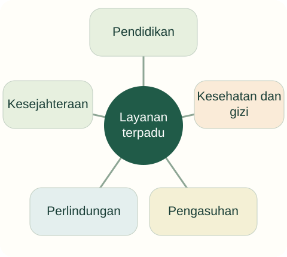

### Kasus ilustratif

Bagaimana satuan PAUD merespons kebutuhan anak yang melintasi layanan?

Seorang anak di RA tetap ingin bermain setelah kegiatan dimulai, tetapi ia beberapa kali tampak lelah dan keluarganya menanyakan layanan pemantauan tumbuh kembang. Guru mendiskusikan dukungan bersama keluarga dan petugas kesehatan yang berwenang.

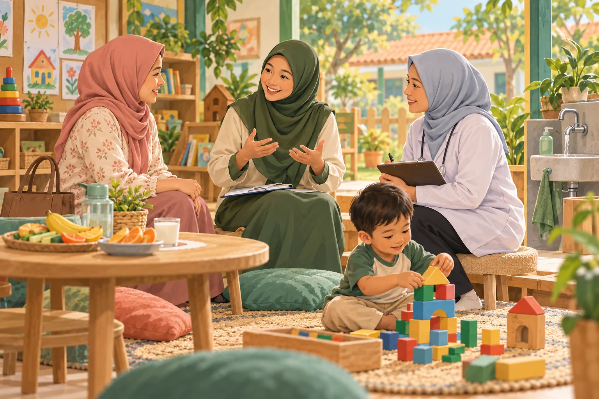

### Pembahasan

Guru menyesuaikan durasi atau memberi pilihan posisi bermain sambil mendokumentasikan pengamatan. Dengan keluarga, satuan menyepakati kapan membahas kembali dan bagaimana menghubungi layanan yang memang berwenang bila diperlukan.

### Latihan terbimbing

Kelompokkan contoh tindakan dalam kasus berdasarkan kewenangan guru, keluarga, dan tenaga kesehatan. Jelaskan siapa yang mengoordinasikan tindak lanjut di tingkat satuan.

### Latihan mandiri

Susun peta layanan sekitar satu RA untuk pendidikan, kesehatan, dan perlindungan. Tulis satu alur komunikasi yang menjaga kerahasiaan anak.

### Refleksi

Tindakan apa yang dapat saya ambil di kelas sembari menunggu informasi dari pihak lain?

### Referensi

- Republik Indonesia. (2003). Undang-Undang Nomor 20 Tahun 2003 tentang Sistem Pendidikan Nasional. https://peraturan.bpk.go.id/Details/43920/uu-no-20-tahun-2003

- Republik Indonesia. (2013). Peraturan Presiden Nomor 60 Tahun 2013 tentang Pengembangan Anak Usia Dini Holistik-Integratif. https://peraturan.bpk.go.id/Details/41430/perpres-no-60-tahun-2013

- Republik Indonesia. (2021). Peraturan Pemerintah Nomor 57 Tahun 2021 tentang Standar Nasional Pendidikan, sebagaimana diubah dengan Peraturan Pemerintah Nomor 4 Tahun 2022. https://pmp.kemendikdasmen.go.id/sistem/hukum

- Kementerian Pendidikan Dasar dan Menengah. (2025). Peraturan Menteri Pendidikan Dasar dan Menengah Nomor 10 Tahun 2025 tentang Standar Kompetensi Lulusan pada Pendidikan Anak Usia Dini, Jenjang Pendidikan Dasar, dan Jenjang Pendidikan Menengah. https://peraturan.go.id/id/permendikdasmen-no-10-tahun-2025

- Kementerian Pendidikan Dasar dan Menengah. (2025). Peraturan Menteri Pendidikan Dasar dan Menengah Nomor 12 Tahun 2025 tentang Standar Isi pada Pendidikan Anak Usia Dini, Jenjang Pendidikan Dasar, dan Jenjang Pendidikan Menengah. https://jdih.kemendikdasmen.go.id/sjdih/siperpu/dokumen/salinan/Permendikdasmen_No_12_Tahun_2025_ttg_Standar_Isi_pada_Pe.pdf

- Kementerian Pendidikan Dasar dan Menengah. (2025). Peraturan Menteri Pendidikan Dasar dan Menengah Nomor 13 Tahun 2025 tentang Perubahan atas Permendikbudristek Nomor 12 Tahun 2024 tentang Kurikulum pada Pendidikan Anak Usia Dini, Jenjang Pendidikan Dasar, dan Jenjang Pendidikan Menengah. https://peraturan.bpk.go.id/Details/322506/permendikdasmen-no-13-tahun-2025

- Badan Standar, Kurikulum, dan Asesmen Pendidikan. (2025). Keputusan Kepala BSKAP Nomor 046/H/KR/2025 tentang Capaian Pembelajaran pada Pendidikan Anak Usia Dini, Jenjang Pendidikan Dasar, dan Jenjang Pendidikan Menengah. https://bpmpbabel.kemendikdasmen.go.id/PPID/wp-content/uploads/2025/07/KepKaBSKAP-046_2025-ttg-CP.pdf

- Kementerian Agama. (2025). Keputusan Menteri Agama Nomor 1503 Tahun 2025 tentang Perubahan atas Keputusan Menteri Agama Nomor 450 Tahun 2024 tentang Pedoman Implementasi Kurikulum pada Raudhatul Athfal, Madrasah Ibtidaiyah, Madrasah Tsanawiyah, Madrasah Aliyah, dan Madrasah Aliyah Kejuruan. https://jdih.kemenag.go.id/regulation/keputusan-menteri-agama-nomor-1503-tahun-2025-tentang-perubahan-atas-keputusan-menteri-agama-nomor-450-tahun-2024-tentang-pedoman-implementasi-kurikulum-kurikulum-pada-raudhatul-athfal-madrasah-ibtidaiyah-madrasah-tsanawiyah-madrasah-aliyah-dan-madrasah-aliyah-kejuruan

- Suyadi, & Ulfah, M. (2013). Konsep dasar PAUD. Remaja Rosdakarya. https://www.rosda.id/konsep-dasar-paud/

## 10. Nilai Islam dalam pendidikan anak usia dini

Menerjemahkan nilai ke dalam teladan, pembiasaan, dialog, dan tindakan anak.

### Tujuan

- Menguraikan pesan pendidikan dalam nasihat Luqman

- Membedakan pembiasaan, keteladanan, dan dialog

- Memilih bukti perilaku yang relevan dengan tujuan nilai

### Nasihat Luqman sebagai sumber nilai

Al-Qur’an Surah Luqman 31:13–19 memuat nasihat dalam relasi orang tua dan anak, dengan tema tauhid, syukur, tanggung jawab, kesabaran, serta sikap kepada orang lain. Bagian ini dapat menjadi sumber untuk membahas arah pendidikan Islam. Mahasiswa perlu membedakan isi normatif ayat, tafsir, dan pilihan pedagogis yang mereka usulkan. Misalnya, guru menghubungkan syukur dengan merawat makanan yang diterima. Hubungan tersebut perlu dijelaskan dengan bahasa dan tindakan yang dapat dijangkau anak.

### Kebiasaan membuka kesempatan memahami

Pembiasaan memberi struktur dan kesempatan mengulang tindakan. Keteladanan membuat nilai terlihat pada perilaku nyata pendidik. Dialog memberi anak kesempatan menghubungkan tindakan dengan alasan dan akibat yang dekat dengan pengalaman. Ketiganya dapat digunakan saat makan. Anak mengenali urutan persiapan, melihat guru menawari bantuan dengan sopan, dan bercakap tentang bagaimana memastikan semua teman bisa makan dengan nyaman.

### Memilih tujuan dan membaca bukti

Tujuan perlu cukup jelas agar guru tahu pengalaman apa yang akan disediakan dan informasi apa yang bermakna. Mengikuti lafal doa menunjukkan kemampuan berpartisipasi dalam satu rutinitas. Menawarkan bantuan dan menyebut alasan memberi informasi tentang respons sosial dalam situasi tertentu. Guru dapat mencatat tindakan itu dengan konteksnya dan menyediakan kesempatan lain untuk bertindak. Perkembangan nilai memerlukan pengamatan yang proporsional terhadap apa yang tampak.

### Martabat anak dan peran RA

Kurikulum RA mengikuti pedoman yang berlaku pada satuannya. Pendidik dapat memilih contoh nilai Islam dari percakapan dan kegiatan nyata sekaligus menjaga martabat dan perlindungan anak. Bila anak diam saat doa, guru dapat memberi waktu, mencontohkan dengan tenang, atau menawarkan partisipasi bertahap. Saat makanan tumpah, guru dapat menunjukkan cara membersihkan dan mengajak anak membantu sesuai kemampuan. Tindakan guru memberi contoh tanggung jawab dalam keadaan sehari-hari.

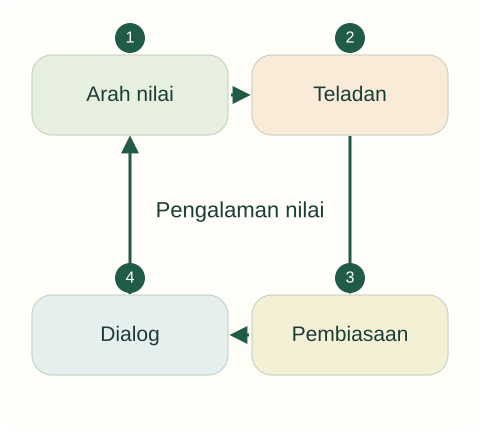

### Kasus ilustratif

Bagaimana rutinitas doa dapat dihubungkan dengan pengalaman memahami nilai?

Sebelum makan, beberapa anak mengikuti doa bersama. Saat satu anak lupa membawa buah, temannya menawarkan sebagian. Guru bertanya apa yang membuat temannya memilih berbagi.

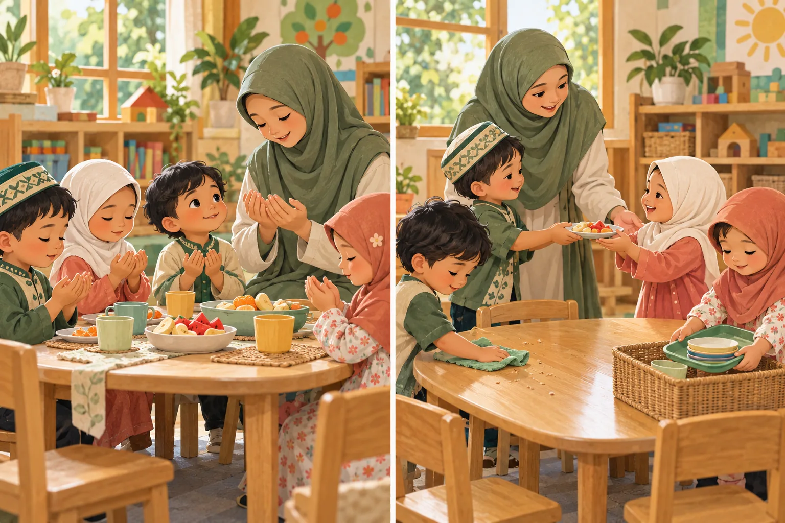

### Pembahasan

Pada kasus makan, guru dapat menghargai niat membantu dan menanyakan kebutuhan teman sebelum berbagi. Di kesempatan lain, amati apakah anak memperhatikan keperluan temannya ketika memakai alat bersama.

### Latihan terbimbing

Pilih satu nilai dari Surah Luqman. Tuliskan contoh teladan guru, rutinitas yang memberi kesempatan mencoba, dan pertanyaan yang dapat dijawab anak dengan bahasanya sendiri.

### Latihan mandiri

Susun satu skenario penanganan alat bersama yang mengembangkan amanah. Jelaskan sumber nilai, tindakan pendidik, pilihan anak, dan bukti yang dapat diamati.

### Refleksi

Apakah tindakan saya saat terjadi kesalahan sejalan dengan nilai yang saya ajarkan?

### Referensi

- Al-Qur’an. Surah Luqman (31), ayat 13–19. https://quran.com/id/luqman/13-19

- Kementerian Agama. (2025). Keputusan Menteri Agama Nomor 1503 Tahun 2025 tentang Perubahan atas Keputusan Menteri Agama Nomor 450 Tahun 2024 tentang Pedoman Implementasi Kurikulum pada Raudhatul Athfal, Madrasah Ibtidaiyah, Madrasah Tsanawiyah, Madrasah Aliyah, dan Madrasah Aliyah Kejuruan. https://jdih.kemenag.go.id/regulation/keputusan-menteri-agama-nomor-1503-tahun-2025-tentang-perubahan-atas-keputusan-menteri-agama-nomor-450-tahun-2024-tentang-pedoman-implementasi-kurikulum-kurikulum-pada-raudhatul-athfal-madrasah-ibtidaiyah-madrasah-tsanawiyah-madrasah-aliyah-dan-madrasah-aliyah-kejuruan

- Republik Indonesia. (2014). Undang-Undang Nomor 35 Tahun 2014 tentang Perubahan atas Undang-Undang Nomor 23 Tahun 2002 tentang Perlindungan Anak. https://peraturan.bpk.go.id/Details/38723/uu-no-35-tahun-2014

## 11. Anak sebagai subjek dan relasi pedagogis

Menggunakan observasi, partisipasi, dan penyesuaian akses dalam interaksi kelas.

### Tujuan

- Menjelaskan relasi pedagogis yang responsif

- Memeriksa hambatan partisipasi

- Merancang penyesuaian tanpa kehilangan tujuan belajar

### Relasi pedagogis dalam tindakan

Pertemuan 2 membahas kedudukan anak sebagai subjek. Unit ini menelaah cara guru menjalankan tanggung jawab tersebut melalui interaksi. Relasi pedagogis bersifat asimetris karena guru bertanggung jawab atas lingkungan dan batas keselamatan, sementara anak tetap memiliki suara dan kemungkinan mengambil keputusan. Respons dimulai dari mengamati, memberi waktu, dan memeriksa maksud anak sebelum menambah tuntutan.

### Praktik sesuai perkembangan

NAEYC (2020, 2022) menekankan pola perkembangan umum, keunikan anak, dan konteks budaya serta sosial. Guru dapat memakai ketiganya untuk menafsirkan peristiwa yang sama. Dalam satu kegiatan, diam mungkin berkaitan dengan banyaknya orang, bahasa yang digunakan, atau bentuk tugas yang belum familier. Membandingkan respons saat bercerita dalam pasangan dan kelompok besar memberi informasi yang lebih spesifik untuk merancang dukungan.

### Akses dan tujuan

Tujuan “mengomunikasikan pengalaman” dapat dicapai melalui ucapan, gambar, isyarat, atau alat komunikasi yang digunakan anak. Jika tujuannya memang menggunakan kosakata lisan, guru dapat mulai dari menunjuk, lalu memberi contoh satu kata dan menunggu respons. Prinsip akomodasi yang layak bagi peserta didik penyandang disabilitas dirujuk melalui PP No. 13 Tahun 2020. Penyesuaian pedagogis sehari-hari tetap dapat dilakukan untuk mengurangi hambatan pada semua anak.

### Pengamatan dan penyesuaian

Catat konteks, tindakan guru, dan respons anak. Keterangan “setelah diberi pilihan menunjuk atau berbicara, anak menunjuk gambar pohon dan menyebut ‘besar sekali’” dapat ditindaklanjuti. Guru mungkin mencoba percakapan kelompok kecil atau mengizinkan anak memilih urutan bercerita. Hak untuk didengar memberi dasar normatif bagi praktik tersebut. Bukti partisipasi membantu guru menilai apakah penyesuaian bekerja di kelasnya.

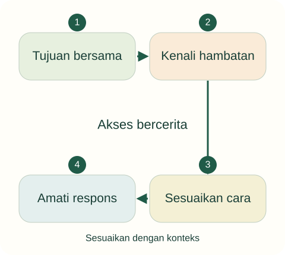

### Kasus ilustratif

Bagaimana anak dapat bercerita ketika cara berpartisipasi di kelas terlalu sempit?

Saat diminta bercerita di depan kelompok, seorang anak memegang gambar dan diam. Guru duduk sejajar, mengajak anak menunjuk bagian gambar, lalu mendengarkan ketika anak menambahkan dua kata.

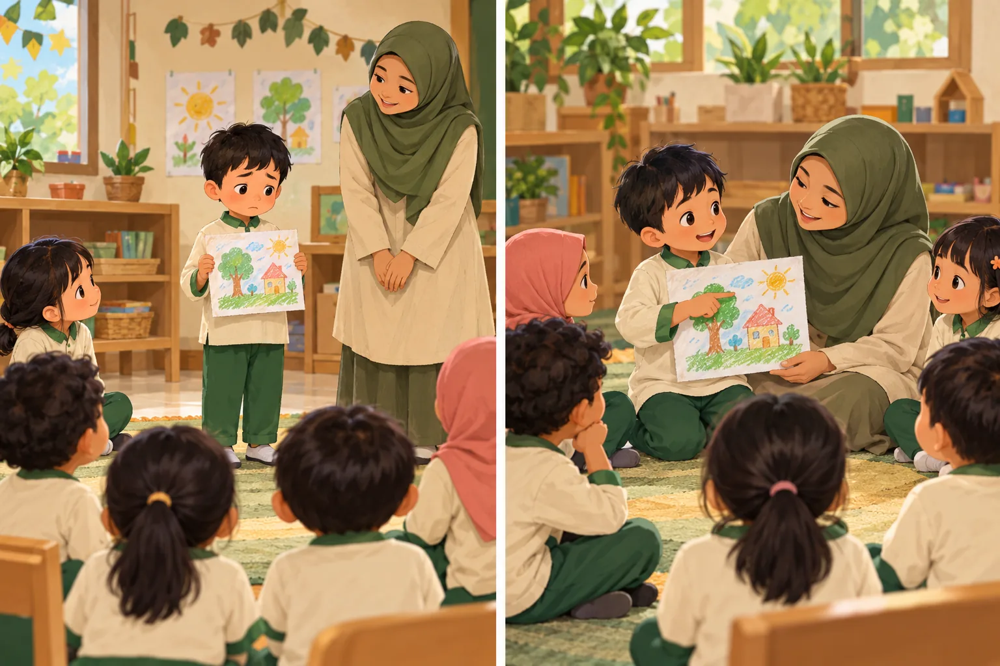

### Pembahasan

Menunjuk membuka akses untuk memulai cerita, lalu ucapan dua kata memberi bukti tambahan. Pertahankan tujuan berkomunikasi, coba pengaturan berpasangan, dan bandingkan apa yang dapat disampaikan anak.

### Latihan terbimbing

Bedakan catatan peristiwa, dugaan, dan perubahan yang dicoba. Gunakan contoh anak diam ketika diminta menjelaskan gambar di depan kelompok.

### Latihan mandiri

Rancang dua cara menunjukkan pemahaman pada tugas bercerita. Tulis satu tujuan bersama dan satu bukti bagi setiap cara.

### Refleksi

Saat ikut berbicara sulit bagi anak, pilihan apa yang dapat saya tawarkan tanpa mengambil alih ceritanya?

### Referensi

- National Association for the Education of Young Children. (2020). Developmentally appropriate practice: A position statement. https://www.naeyc.org/resources/position-statements/dap/contents

- National Association for the Education of Young Children. (2022). Developmentally appropriate practice in early childhood programs serving children from birth through age 8 (4th ed.). https://www.naeyc.org/Resources/Pubs/Books/Dap-Fourth-Edition

- United Nations. (1989). Convention on the Rights of the Child. https://www.ohchr.org/sites/default/files/crc.pdf

- Republik Indonesia. (2020). Peraturan Pemerintah Nomor 13 Tahun 2020 tentang Akomodasi yang Layak untuk Peserta Didik Penyandang Disabilitas. https://peraturan.bpk.go.id/Details/132596/pp-no-13-tahun-2020

## 12. Bermain, pengalaman, dan lingkungan belajar

Merancang bermain terbimbing dengan tujuan, pilihan anak, dan bantuan yang sesuai.

### Tujuan

- Membedakan bermain bebas, bermain terbimbing, dan pengajaran langsung

- Merancang pilihan anak serta bantuan bertahap

- Menafsirkan bukti penelitian bermain secara terbatas

### Tiga cara mengatur pengalaman

Dalam bermain bebas, anak terutama menentukan arah dan tindakan. Dalam bermain terbimbing, pendidik menyiapkan tujuan belajar dan lingkungan serta memberi dukungan, sementara anak tetap memiliki pilihan bermakna. Dalam pengajaran langsung, pendidik mengambil peran utama mencontohkan atau menjelaskan cara tertentu. Ketiganya dapat muncul dalam satu hari belajar. Pada permainan pasar, anak dapat memilih peran dan barang. Guru menjaga tujuan bilangan dengan menata benda yang dapat dihitung dan memberi petunjuk ketika dibutuhkan.

### Menentukan kapan guru masuk

Guru dapat mengamati terlebih dahulu peran, strategi, dan persoalan yang sedang dihadapi anak. Jika jumlah wortel belum cocok, pertanyaan “bagaimana kita memeriksa pesanan ini?” membuka ruang untuk menentukan cara memeriksa. Bila anak kesulitan, guru dapat mencontohkan menyentuh satu benda setiap menyebut satu bilangan. Setelah itu, anak mencoba pada pesanan berikutnya. Gagasan bantuan sementara dapat dibaca melalui Wood et al. (1976).

### Apa yang didukung penelitian

Tinjauan sistematis dan meta-analisis Skene et al. (2022) menemukan keunggulan bermain terbimbing pada sebagian hasil dan pembanding tertentu, termasuk matematika awal dan pengenalan bentuk dibanding pengajaran langsung, serta kosakata spasial dibanding bermain bebas. Banyak hasil lain tidak menunjukkan perbedaan yang jelas, dan bentuk bimbingan bervariasi antarstudi. Temuan ini memberi dasar untuk memilih pendekatan sesuai tujuan, lalu memeriksa bagaimana rancangan tertentu dijalankan dan direspons di kelas.

### Merancang lingkungan dan bukti

Gunakan benda yang dapat dipindahkan dan cukup mudah diakses. Bukti dipilih sesuai tujuan. Bila tujuannya mencocokkan jumlah, amati apakah anak menyentuh satu wortel setiap menyebut angka dan berhenti pada jumlah yang diminta. Bila tujuannya bergiliran, amati bagaimana anak menyatakan usul dan menerima peran. Kesinambungan pengalaman dapat dilihat saat anak memakai strategi pada pesanan berbeda atau pada permainan lain.

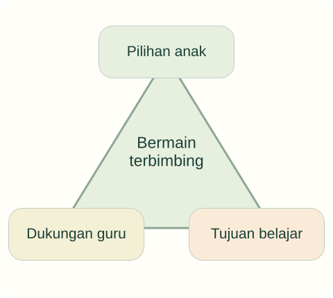

### Kasus ilustratif

Kapan pertanyaan guru membantu permainan berkembang?

Dalam bermain pasar, anak memilih menjadi penjual atau pembeli dan menyiapkan keranjang. Seorang pembeli meminta tiga wortel. Penjual memasukkan beberapa wortel dengan cepat. Guru mendengarkan sebelum menawarkan pertanyaan.

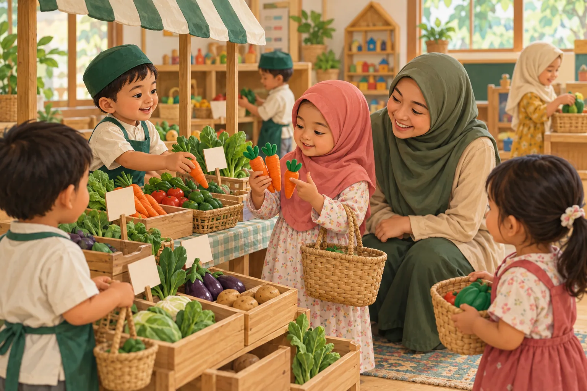

### Pembahasan

Biarkan penjual memilih cara memeriksa keranjang. Beri contoh singkat jika strategi yang dipilih belum membantu. Pada pesanan berikutnya, lihat apa yang anak lakukan dengan bantuan yang dikurangi.

### Latihan terbimbing

Rancang satu giliran bermain pasar. Nyatakan satu tujuan, dua pilihan untuk anak, satu pertanyaan pembuka, dan satu petunjuk lanjutan jika diperlukan.

### Latihan mandiri

Alihkan rancangan ke permainan bengkel atau dapur. Tuliskan pilihan yang dipertahankan pada anak dan bukti yang akan diamati saat dukungan dikurangi.

### Refleksi

Kapan pertanyaan saya memperpanjang penyelidikan anak? Kapan pertanyaan itu justru memutus alur permainan?

### Referensi

- Dewey, J. (1997). Experience and education. Touchstone. (Original work published 1938) https://www.simonandschuster.com/books/Experience-And-Education/John-Dewey/9780684838281

- Skene, K., O’Farrelly, C. M., Byrne, E. M., Kirby, N., Stevens, E. C., & Ramchandani, P. G. (2022). Can guidance during play enhance children’s learning and development in educational contexts? A systematic review and meta-analysis. Child Development, 93(4), 1162–1180. https://doi.org/10.1111/cdev.13730

- Wood, D., Bruner, J. S., & Ross, G. (1976). The role of tutoring in problem solving. Journal of Child Psychology and Psychiatry, 17(2), 89–100. https://doi.org/10.1111/j.1469-7610.1976.tb00381.x

- Yogman, M., Garner, A., Hutchinson, J., Hirsh-Pasek, K., Golinkoff, R. M., Committee on Psychosocial Aspects of Child and Family Health, & Council on Communications and Media. (2018). The power of play: A pediatric role in enhancing development in young children. Pediatrics, 142(3), Article e20182058. https://doi.org/10.1542/peds.2018-2058

## 13. Pendidikan, keluarga, dan kebudayaan

Menjelaskan pewarisan budaya, peluang partisipasi, dan cara berdialog dengan keluarga.

### Tujuan

- Menjelaskan sosialisasi melalui kebiasaan

- Menganalisis dampak pengelompokan terhadap kesempatan belajar

- Merancang dialog dengan keluarga

### Pendidikan mewariskan dan menafsirkan budaya

Bahasa, cerita, cara menyapa, dan praktik keluarga dapat masuk ke dalam pendidikan. Biesta (2009) menyebut sosialisasi sebagai salah satu fungsi pendidikan, yakni keterlibatan seseorang dalam cara hidup dan praktik bersama. Anak juga perlu mendapat kesempatan merespons dan memberi alasan. Guru dapat mengenalkan cerita keluarga atau permainan lokal sambil mengundang anak membandingkan cara memainkannya.

### Kurikulum tersembunyi

Dalam pembahasan kehidupan kelas oleh Jackson (1968), kurikulum tersembunyi merujuk pada pesan yang dipelajari melalui aturan, pengelompokan, dan kebiasaan sehari-hari di luar tujuan tertulis. Jika anak selalu diarahkan ke area tertentu berdasarkan jenis kelamin, pembagian kesempatan mengirim pesan tentang peran yang dianggap sesuai. Guru dapat membandingkan siapa yang memperoleh pengalaman menyusun, mengukur, merawat, atau bermain peran ketika akses dibuka.

### Membaca budaya bersama keluarga

Kerangka praktik sesuai perkembangan dari NAEYC (2020) menempatkan konteks sosial budaya sebagai salah satu pertimbangan. Guru dapat bertanya kepada keluarga apa yang mereka hargai dari sebuah kebiasaan, misalnya tanggung jawab membantu pekerjaan rumah atau kebersamaan. Pengaturan bermain dapat menjaga nilai saling membantu sambil memberi semua anak akses ke ragam tugas. Percakapan dengan keluarga membantu memahami arti kebiasaan sebelum mengambil keputusan.

### Menguji perubahan secara proporsional

Pembukaan akses kemungkinan memperluas pengalaman, tetapi respons setiap anak dapat berbeda. Catat pilihan area, durasi keterlibatan, dan jenis tindakan yang dicoba pada beberapa kesempatan. Informasi ini membantu guru melihat apakah undangan yang sama memang memberi akses yang dapat digunakan. Bila bahan sulit dijangkau atau teman mengambil alih, penyesuaian perlu diarahkan pada hambatan yang terlihat.

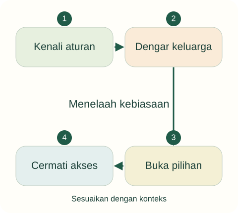

### Kasus ilustratif

Bagaimana satuan PAUD menjaga praktik budaya sambil membuka pilihan anak?

Pada awal bermain, orang dewasa membagi area balok untuk anak laki-laki dan dapur mainan untuk anak perempuan. Pada kesempatan berikutnya, dua keluarga mendampingi kegiatan dan semua anak diizinkan mencoba kedua area.

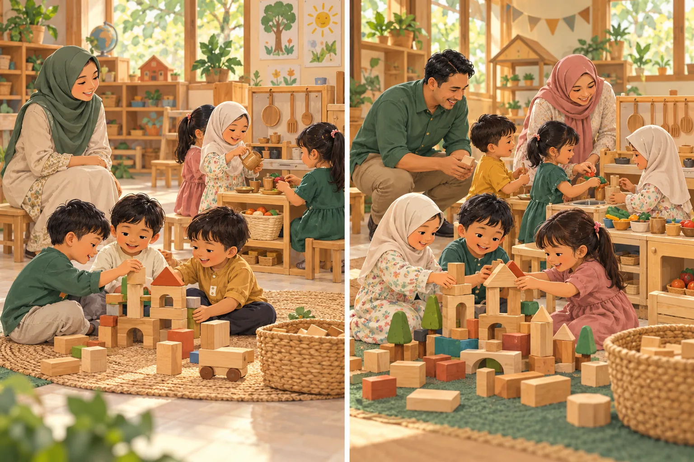

### Pembahasan

Guru menawarkan kedua area kepada semua anak, lalu menyediakan bahan dan contoh peran yang beragam. Keluarga dapat diajak membicarakan manfaat setiap kegiatan bagi perkembangan anak. Catat jenis pengalaman yang mulai diakses.

### Latihan terbimbing

Tinjau satu kebiasaan kelas, misalnya siapa yang diminta membawa benda atau merapikan alat. Jelaskan pesan yang mungkin diterima dan cara menguji dugaan Anda.

### Latihan mandiri

Buat pembuka percakapan dengan keluarga yang ingin mempertahankan pembagian area bermain. Sebutkan nilai yang bisa dijaga, perubahan yang diusulkan, dan cara mengeceknya.

### Refleksi

Aturan kecil apa yang tanpa disadari membatasi pengalaman sebagian anak di kelas?

### Referensi

- Biesta, G. (2009). Good education in an age of measurement: On the need to reconnect with the question of purpose in education. Educational Assessment, Evaluation and Accountability, 21, 33–46. https://doi.org/10.1007/s11092-008-9064-9

- Jackson, P. W. (1968). Life in classrooms. Holt, Rinehart and Winston. https://openlibrary.org/books/OL19584596M/Life_in_classrooms

- National Association for the Education of Young Children. (2020). Developmentally appropriate practice: A position statement. https://www.naeyc.org/resources/position-statements/dap/contents

- United Nations. (1989). Convention on the Rights of the Child. https://www.ohchr.org/sites/default/files/crc.pdf

## 14. Tantangan pendidikan dan literasi digital

Menilai klaim manfaat media, kegiatan pendamping, akses, dan pemrosesan data anak.

### Tujuan

- Menilai cakupan klaim dan pengukuran

- Menentukan tujuan dan bukti penggunaan media

- Menjelaskan pertimbangan privasi dokumentasi

### Dari skor ke klaim

Skor menggambarkan kinerja pada aturan dan tugas tertentu. Kenaikan dapat berkaitan dengan penguasaan pola, latihan mengoperasikan aplikasi, atau hafalan urutan. Untuk menilai klaim, identifikasi kemampuan yang diukur, pembanding, serta konteks pengukuran. Jika tujuan guru adalah mengenali pola berulang, ia dapat meminta anak melanjutkan pola dengan benda berbeda untuk mencari bukti penerapan. Klaim tentang kecerdasan umum membutuhkan ukuran dan rancangan penelitian yang sesuai dengan cakupannya.

### Media dinilai dari pengalaman belajar

Hirsh-Pasek et al. (2015) mengusulkan kerangka untuk menilai aplikasi berdasarkan kesempatan belajar aktif, keterlibatan, kebermaknaan, serta interaksi sosial yang berpijak pada tujuan. Dalam kegiatan pola, guru dapat memilih media yang memungkinkan anak memprediksi elemen selanjutnya, menjelaskan alasan, dan membandingkan susunan bersama teman. Kerangka ini memberi kriteria untuk memeriksa rancangan kegiatan. Manfaat media spesifik tetap memerlukan bukti.

### Akses dan pengalaman yang digantikan

Tablet bersama dapat memberi kesempatan berdiskusi jika setiap anak memiliki cara menyumbang ide. Bila gilirannya terlalu singkat, anak mungkin hanya menekan jawaban. Pertimbangkan ketersediaan perangkat, bahasa, kebutuhan akses, dan waktu yang diambil dari pengalaman langsung. Jika balok dan kancing lebih sesuai untuk mencoba pola, pilih benda tersebut atau gunakan sebagai kegiatan pendamping. Keputusan dimulai dari tujuan dan keadaan satuan.

### Privasi sebagai bagian keputusan pendidikan

UU No. 27 Tahun 2022 Pasal 25 mengatur pemrosesan data pribadi anak secara khusus dan mensyaratkan persetujuan orang tua dan/atau wali sesuai ketentuan. Pasal 27 dan 28 mengarahkan pemrosesan terbatas, spesifik, transparan, dan sesuai tujuan. Dalam komunikasi perkembangan, guru dapat membahas pengamatan secara privat, membatasi informasi yang dikumpulkan, dan mengikuti prosedur satuan. Untuk latihan kuliah, gunakan contoh sintetis tanpa identitas anak.

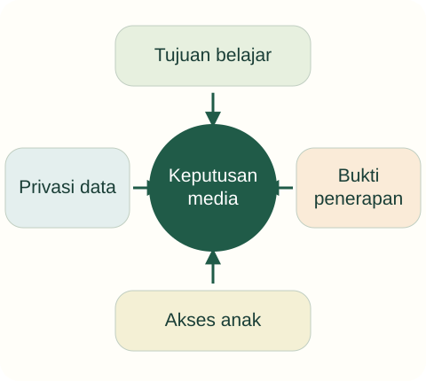

### Kasus ilustratif

Apa yang dapat disimpulkan dari skor aplikasi belajar?

Aplikasi menjanjikan peningkatan kecerdasan melalui permainan pola. Guru melihat skor naik setelah beberapa putaran. Keluarga bertanya apakah skor itu bisa dibagikan untuk membandingkan kemajuan anak.

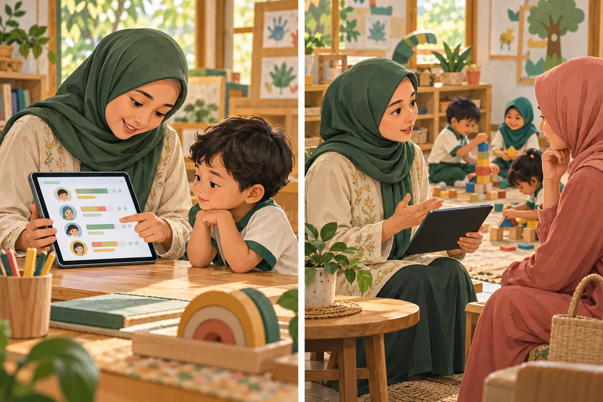

### Pembahasan

Beri tugas pola serupa dengan benda baru, lalu minta anak menunjukkan caranya. Sampaikan hasil kepada keluarga sebagai catatan tentang strategi pada tugas tertentu. Tinjau dasar, tujuan, dan akses sebelum data individual ditangani.

### Latihan terbimbing

Ubah klaim “aplikasi membuat semua anak lebih cerdas” menjadi pertanyaan yang bisa diuji pada satu kemampuan. Tentukan tugas pembanding dan bukti penerapan.

### Latihan mandiri

Bandingkan satu kegiatan digital dengan alternatif benda nyata untuk tujuan yang sama. Jelaskan peran guru, akses, bukti, dan cara menjaga data anak.

### Refleksi

Jika perangkat dihilangkan, bagian mana dari rancangan saya masih memberi pengalaman belajar yang sama?

### Referensi

- Hirsh-Pasek, K., Zosh, J. M., Golinkoff, R. M., Gray, J. H., Robb, M. B., & Kaufman, J. (2015). Putting education in “educational” apps: Lessons from the science of learning. Psychological Science in the Public Interest, 16(1), 3–34. https://doi.org/10.1177/1529100615569721

- Republik Indonesia. (2022). Undang-Undang Nomor 27 Tahun 2022 tentang Pelindungan Data Pribadi. https://peraturan.bpk.go.id/Home/Download/224884/UU%20Nomor%2027%20Tahun%202022.pdf

## 15. Profesionalisme dan analisis kasus integratif

Menggunakan pengetahuan profesi, pengamatan, dan refleksi untuk mengambil keputusan.

### Tujuan

- Menjelaskan tanggung jawab dan batas kompetensi pendidik

- Menganalisis fakta, interpretasi, dan informasi yang kurang

- Menetapkan tindakan, bukti, dan waktu peninjauan

### Profesionalisme sebagai pertanggungjawaban

UU No. 14 Tahun 2005 menempatkan guru pada PAUD jalur formal, pendidikan dasar, dan pendidikan menengah serta memuat kompetensi pedagogik, kepribadian, sosial, dan profesional. Kompetensi tersebut terlihat saat guru merancang pengalaman belajar, berkomunikasi dengan keluarga, memakai pengetahuan yang relevan, dan menjaga martabat anak. Tindakan profesional dapat ditinjau dari alasan, pelaksanaan, bukti, dan tindak lanjutnya.

### Merumuskan persoalan yang bisa ditangani

Mulai dari pengamatan. Kapan anak meninggalkan meja, apa tuntutan kegiatannya, apa yang dilakukan sebelum dan sesudahnya, serta kapan ia tetap bertahan? Catatan “meninggalkan meja setelah mencoba menyalin dua huruf” berbeda dari dugaan “malas menulis”. Hubungi keluarga untuk mengetahui apa yang biasa dilakukan anak di rumah. Guru dapat mempertimbangkan durasi, tuntutan gerak, bahan, pemahaman instruksi, dan minat sebelum memilih langkah awal.

### Menimbang dan menguji respons

Bandingkan respons yang mungkin. Guru dapat mempersingkat tugas, menyediakan alat yang mudah digunakan, atau memasukkan simbol dan coretan bermakna pada permainan. Jika memilih kartu nama bangunan, tentukan tujuan yang dipertahankan, misalnya menggunakan tanda untuk menyampaikan makna. Catat apakah anak mulai membuat atau menjelaskan tanda dengan dukungan yang realistis. Ketika informasi memerlukan kompetensi pihak lain, guru mengoordinasikan konsultasi sesuai prosedur satuan.

### Refleksi selama dan setelah tindakan

Schön (1983) membahas bagaimana praktisi dapat memikirkan dan menyesuaikan tindakan ketika menghadapi situasi yang sedang berlangsung. Guru dapat mengubah bantuan saat melihat anak tertahan pada instruksi, lalu meninjau catatan setelah kegiatan. Bila anak dapat memberi makna pada tanda di permainan, guru memperoleh petunjuk untuk merancang kesempatan berikutnya. Refleksi juga menuntut guru memeriksa keputusan awalnya sendiri dan menjelaskan dasar perubahan kepada keluarga.

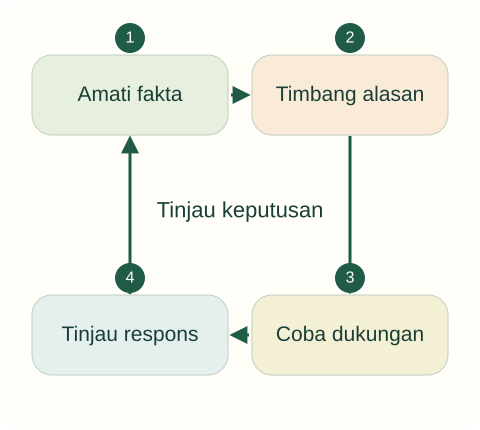

### Kasus ilustratif

Bagaimana guru bertindak ketika keluarga, lembaga, dan anak memerlukan hal yang berbeda?

Seorang anak beberapa kali meninggalkan meja pada kegiatan menulis, tetapi bertahan lama saat membangun dengan balok. Keluarga meminta hukuman agar ia terbiasa. Kepala RA meminta guru menyiapkan laporan dan langkah tindak lanjut.

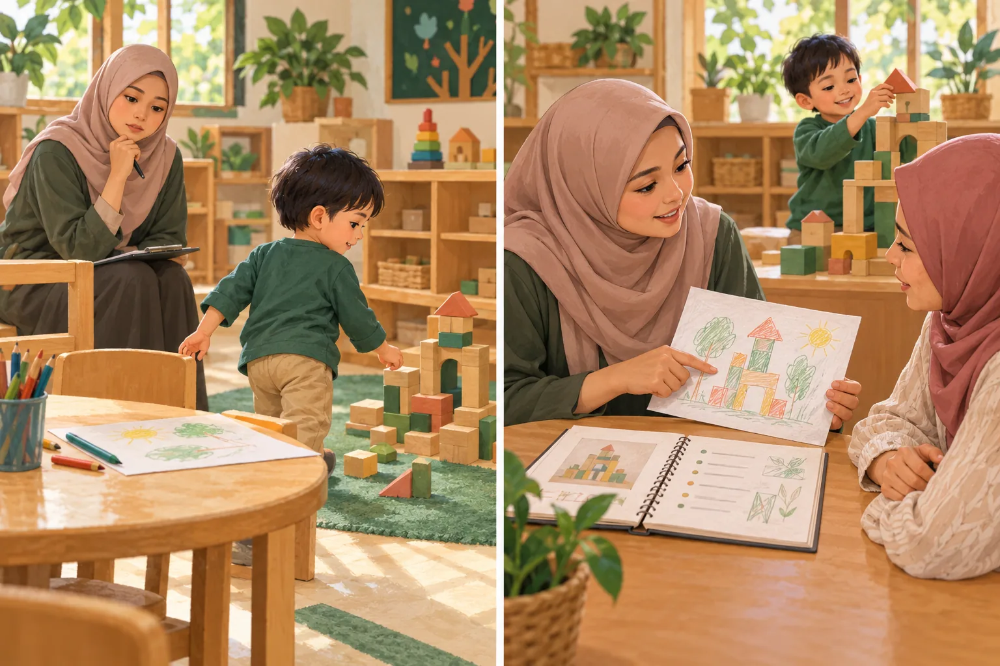

### Pembahasan

Tentukan satu dukungan awal, misalnya membuat tanda untuk bangunan yang dipilih anak. Catat pilihan, bantuan, dan cara anak menggunakan tanda. Sepakati dengan keluarga kapan guru akan meninjau respons dan apa yang perlu didiskusikan kembali.

### Latihan terbimbing

Susun enam bagian memo: fakta, masalah, konsep dan aturan, dua pilihan, keputusan, peninjauan. Tulis satu data yang masih kurang pada bagian fakta.

### Latihan mandiri

Tulis memo keputusan 400–600 kata. Gunakan minimal dua sumber sesuai fungsi, jelaskan dua alternatif, dan tetapkan bukti, waktu peninjauan, serta pihak yang terlibat.

### Refleksi

Bagian mana dari kesimpulan saya yang akan berubah jika keluarga memberi informasi baru?

### Referensi

- Republik Indonesia. (2005). Undang-Undang Nomor 14 Tahun 2005 tentang Guru dan Dosen. https://peraturan.bpk.go.id/Download/29906/UU_Nomor_14_Tahun_2005.pdf

- Schön, D. A. (1983). The reflective practitioner: How professionals think in action. Basic Books. https://books.google.com/books?id=oYNHAAAAMAAJ

- Republik Indonesia. (2014). Undang-Undang Nomor 35 Tahun 2014 tentang Perubahan atas Undang-Undang Nomor 23 Tahun 2002 tentang Perlindungan Anak. https://peraturan.bpk.go.id/Details/38723/uu-no-35-tahun-2014

- National Association for the Education of Young Children. (2020). Developmentally appropriate practice: A position statement. https://www.naeyc.org/resources/position-statements/dap/contents

- Kementerian Pendidikan, Kebudayaan, Riset, dan Teknologi. (2022). Peraturan Menteri Pendidikan, Kebudayaan, Riset, dan Teknologi Nomor 21 Tahun 2022 tentang Standar Penilaian Pendidikan pada Pendidikan Anak Usia Dini, Jenjang Pendidikan Dasar, dan Jenjang Pendidikan Menengah. https://peraturan.bpk.go.id/Details/224425/permendikbudriset-no-21-tahun-2022